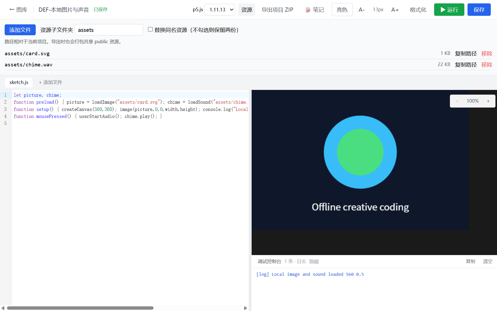
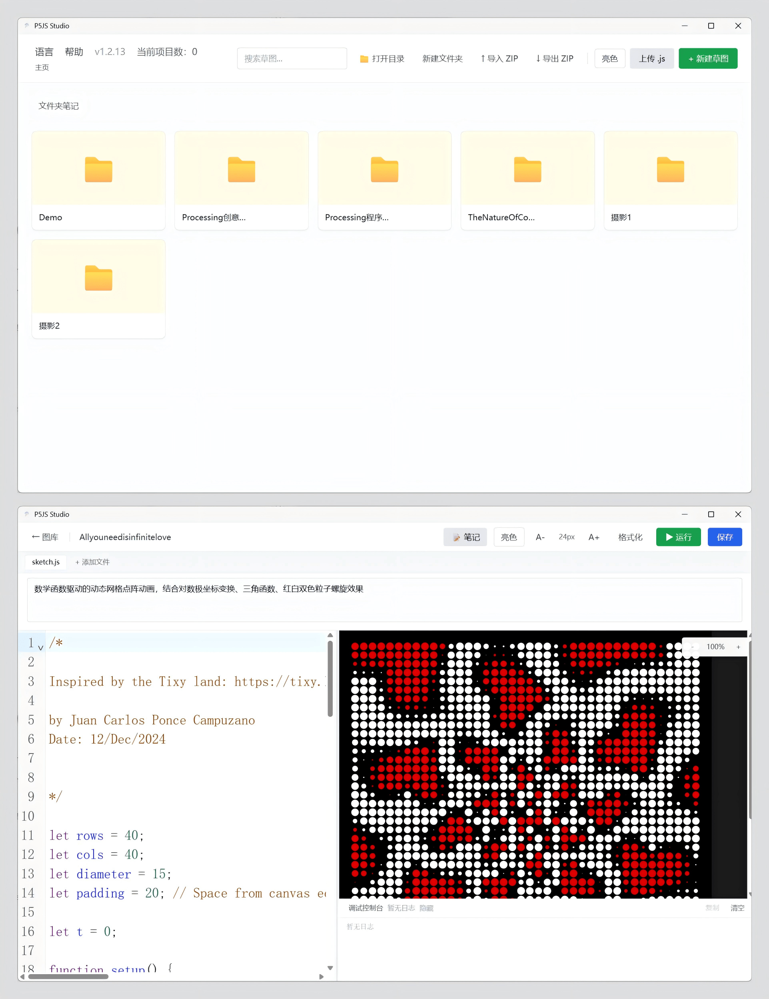

# P5JS Studio

[English](README.md) | [简体中文](README.zh-CN.md)

P5JS Studio 是一个本地桌面版 [p5.js](https://p5js.org) 创意编程 IDE，基于 Tauri、React、TypeScript 和 CodeMirror 构建。它可以离线编写、运行、整理、调试和备份草图，内置图库、文件夹式草图管理、实时预览、多文件草图、笔记、缩略图、本地资源和第三方库、代码格式化、p5 补全提示、调试输出、预览缩放，以及亮色/暗色主题。

## 界面预览



1.3 的资源面板、项目 ZIP 导出与版本选择。此图使用仓库自制的匿名教学示例。



P5JS Studio 的文件夹归档与编辑预览界面。编辑器中展示的演示草图作者为 Juan Carlos Ponce Campuzano，此处用于展示软件运行效果。

## 功能

### 图库

- 文件管理器式图库，支持文件夹、面包屑导航和草图卡片。
- 支持多层文件夹，可按班级、主题、作业或项目整理草图。
- 包含 `meta.json` 的文件夹会被识别为草图；没有 `meta.json` 的文件夹会作为分类目录。
- 分类文件夹也可以保存自己的笔记，笔记会写入 `.folder.json`。
- 从编辑器返回图库时，会保留当前所在文件夹和面包屑路径。
- 点击运行草图 1.5 秒后自动截取缩略图。
- 草图卡片显示笔记摘要。
- 单项目可选 1～5 星评分，可清除回未评分；收藏是独立开关，与评分互不影响。
- 可搜索项目名、目录路径和笔记，支持多个关键词，并组合评分／未评分、只看收藏筛选；范围可选全部项目或当前文件夹。
- 评分（`rating: 0` 表示未评分）与收藏（`favorite`）写入 `meta.json`，编辑保存、改名、移动和项目 ZIP 导入导出均保留。老项目默认未评分、未收藏。
- 支持把 `.js` 文件拖进窗口直接导入。
- 支持通过文件选择器上传单个 `.js` 草图。
- 支持在文件夹之间移动草图。
- 支持重命名文件夹和删除空文件夹。
- 支持把所有草图导入/导出为 `.zip` 压缩包，并保留完整目录结构。
- 可直接从应用中打开本地草图存储目录。
- 支持英文 / 简体中文界面切换。
- 内置 Help 帮助面板，说明主要功能和快捷键。

### 编辑器

- 左侧 CodeMirror 编辑器，右侧 p5 实时预览，中间分割线可左右拖动。
- 支持多文件草图，可通过文件标签栏添加额外 `.js` 文件。
- 同一个草图内的所有文件会按标签顺序拼接运行，并共享同一个 p5 全局作用域。
- 每个草图都有独立笔记面板。
- 点击工具栏里的草图名可以重命名。
- 点击运行时，会先自动保存当前草图文件和笔记，再启动预览。
- 提供轻量 p5 补全提示，覆盖常用函数、变量、常量和生命周期模板。
- 提供轻量编辑器诊断，可提示语法错误和常见 p5 函数拼写错误。
- 支持用 Prettier 格式化当前文件，可点击工具栏按钮或使用 `Shift+Alt+F`。
- 支持调整编辑器字体大小：`Ctrl` + 鼠标滚轮、`Ctrl` + `+`、`Ctrl` + `-`，或使用工具栏按钮。
- 支持亮色和暗色 UI 主题，并会记住上次选择。

### 预览与调试

- 预览 iframe 会在隔离沙箱中运行草图。
- 大尺寸画布可以通过滚动条查看。
- 预览缩放控件可以缩小超大画布，也可以一键恢复到 100%。
- Debug Console 会捕获 `console.log`、`console.warn` 和 `console.error`。
- Debug Console 可通过标题栏收起，收起后仍会显示日志数量和最高级别提示。
- Debug Console 工具栏可以一键复制日志为纯文本。
- 运行时错误、语法错误和未处理的 Promise 异常会显示在 Debug Console 中。
- 缩略图会在运行草图后自动截取保存。

### 本地资源

图片可以放在草图目录中，并用普通 p5 路径加载：

```text
sketches/
  particles/
    my-sketch/
      sketch.js
      pic1.png
      meta.json
```

```js
let pic;

function preload() {
  pic = loadImage("pic1.png");
}
```

也可以把多个草图共用的资源放到：

```text
sketches/
  public/
    pic1.png
```

如果草图目录和 `public` 目录里有同名资源，草图目录中的文件优先。当前支持的图片格式包括 `png`、`jpg`、`jpeg`、`gif`、`webp`、`bmp` 和 `svg`。

### 第三方库

`p5.sound` 已内置并默认加载，所以声音类草图可以直接使用 `loadSound()` 等 API。

其他经典浏览器全局脚本库，可以在资源面板管理，也可以编辑草图目录里的 `meta.json`。把库文件放到草图目录或共享 `public` 文件夹，然后把相对路径写进 `libraries` 数组：

```json
{
  "files": ["sketch.js"],
  "libraries": ["libraries/matter.min.js", "libraries/p5.play.js"]
}
```

示例目录结构：

```text
sketches/
  physics-demo/
    meta.json
    sketch.js
    libraries/
      matter.min.js
      p5.play.js
```

库会按数组顺序在草图代码之前加载。草图目录里的同名库优先于 `public` 中的共享库。缺失的已声明库会在运行前提示具体路径。

资源面板可管理本地脚本声明与加载顺序。它支持会暴露浏览器全局变量的本地传统脚本，不支持自动安装 npm 包、ES module import，或自动从 CDN 下载。

### 可选第三方库兼容

第三方库服务于已有作品的归档与离线复现。P5JS Studio 提供统一的本地经典脚本加载，不提供专用机器学习或 3D 工作台，也不承诺任意库、模型或版本全面兼容。已有 ml5 路径适配继续保留。

在编辑器的 **资源 → 项目依赖（可选）** 中选择本地 JS、调整加载顺序或移除声明，修改随项目保存，下次运行生效。缺失或无法读取的已声明脚本会在运行前列出；检查不会执行库，也不能证明模型、动态资源或在线 API 离线可用。先通过“添加文件”放入项目，或使用已有共享 public 文件。

ml5 的可选配置见 [本地模型兼容说明](docs/optional-ml5-models.zh-CN.md)。

## 快捷键

| 快捷键 | 功能 |
| --- | --- |
| `Ctrl+Enter` | 运行当前草图 |
| `Ctrl+S` | 保存当前草图 |
| `Shift+Alt+F` | 格式化当前文件 |
| `Ctrl` + 鼠标滚轮 | 调整编辑器字体大小 |
| `Ctrl++` / `Ctrl+-` | 增大或减小编辑器字体 |

在 macOS 上也支持 `Cmd+S` 保存。

## 技术栈

| 层级 | 技术 |
| --- | --- |
| 桌面壳 | [Tauri v2](https://tauri.app) |
| 前端 | React 18 + TypeScript + Vite |
| 样式 | Tailwind CSS |
| 代码编辑器 | CodeMirror 6，通过 `@uiw/react-codemirror` 使用 |
| 代码格式化 | Prettier |
| 状态管理 | Zustand |
| p5 运行时 | 本地打包的 p5 v1 |
| 后端 / 文件 I/O | Rust、`std::fs`、`zip`、`base64` |
| CI / 发布 | GitHub Actions、Node 22、`tauri-apps/tauri-action` |

## 草图存储

应用会把草图保存在 Tauri 应用数据目录中：

```text
<app-data>/com.p5jsstudio.app/sketches/
  particles/
    my-sketch/
      meta.json
      sketch.js
      utils.js
      pic1.png
      thumbnail.png
  class-1/
    .folder.json
    student-1/
      meta.json
      sketch.js
  public/
    shared-image.png
```

`meta.json` 保存草图笔记、第三方库声明和文件顺序。任何包含 `meta.json` 的文件夹都会被识别为草图文件夹；不包含 `meta.json` 的文件夹会作为分类目录。分类文件夹的笔记保存在 `.folder.json`，所以不会把分类目录误识别成草图。旧版单文件 `.js` 草图会在启动时自动迁移为文件夹格式。

常见系统路径：

| 平台 | 草图目录 |
| --- | --- |
| Windows | `%APPDATA%\com.p5jsstudio.app\sketches` |
| macOS | `~/Library/Application Support/com.p5jsstudio.app/sketches` |
| Linux | `~/.local/share/com.p5jsstudio.app/sketches` |

编辑器的 p5.js 下拉框选择内置的 **1.11.13** 或 **2.3.4**，并在下次运行时生效。每个项目在 `meta.json` 的 `p5Version` 中保存精确版本。旧项目缺失此字段时默认使用当前 1.x 内置版本（本版 1.11.13），下次保存写入；全局默认设置仅影响新项目。未安装版本会保留记录并阻止运行，选择内置版本后才能运行。两个版本配有对应的本地声音库。切换版本不会自动改写代码。2.x 的补全和拼写提示暂未启用。

## 开始使用

### 环境要求

- [Node.js](https://nodejs.org) 22 或更新版本。
- [Rust](https://rustup.rs) stable 工具链。
- Windows：Visual Studio Build Tools，需要 C++ 桌面构建工具和 Windows SDK。
- Linux：`libwebkit2gtk-4.1-dev`、`libappindicator3-dev`、`librsvg2-dev`、`patchelf`。
- macOS：普通开发不需要额外系统依赖。

### 开发运行

```bash
git clone https://github.com/kergee/P5JS-Studio.git
cd P5JS-Studio

npm ci
npm run tauri dev
```

### 前端构建检查

```bash
npm run build
```

### 生产构建

```bash
npm run tauri build
```

构建产物会输出到：

```text
src-tauri/target/release/bundle/
```

## GitHub Actions

仓库中已经包含 `.github/workflows/build.yml`。

该工作流会构建以下平台的发布文件：

- macOS 通用二进制。
- Windows MSI 安装包。

有两种触发方式：

1. 打开 GitHub 仓库，进入 **Actions**，选择 **Build & Release**，点击 **Run workflow**。
2. 推送版本标签：

```bash
git tag v1.2.9
git push origin v1.2.9
```

推送匹配 `v*` 的 tag 后，会通过 `tauri-apps/tauri-action` 创建一个 GitHub Release。

### Release Notes 和变更日志

当前 workflow 会创建一个带下载说明的 GitHub Release。Action 构建完成后，可以进入 GitHub 的 Releases 页面编辑 Release，然后点击 **Generate release notes**，让 GitHub 根据合并记录和提交记录自动生成一版变更说明。

一个实用发布流程是：

```bash
git tag v1.2.9
git push origin v1.2.9
```

然后打开 **GitHub > Releases**，编辑草稿 Release，点击 **Generate release notes**，检查内容后发布。

如果还想在仓库里保留独立变更日志，可以维护一个 `CHANGELOG.md`，把检查过的 release notes 复制进去。后续如果想更自动化，可以采用 Conventional Commits，再接入 `release-please` 或 `standard-version` 这类工具。

## 使用指南

### 创建草图

1. 在图库中点击 **+ New Sketch**。
2. 在编辑器中编写 p5.js 代码。
3. 点击 **Run** 或按 `Ctrl+Enter` 运行。运行前会先自动保存草图。
4. 如果只想保存但不运行，可以点击 **Save** 或按 `Ctrl+S`。

### 使用多文件

点击文件标签栏中的 **+ Add File**。文件会保存在草图文件夹内，并在预览运行时按标签顺序拼接。

### 使用文件夹整理

点击 **New Folder** 创建分类目录，然后在目录里新建草图。面包屑导航可以回到上级目录。如果从子目录打开草图，再返回图库，会继续停留在原来的子目录。草图卡片上的 **Move** 可以把草图移动到其他文件夹。

分类文件夹在图库里也有自己的笔记区域。文件夹笔记会保存到该目录下的 `.folder.json`。如果一个文件夹里只有 `.folder.json`，删除时仍会按空文件夹处理。

### 使用图片

把图片文件放到草图文件夹或共享的 `public` 文件夹，然后使用普通 p5 代码：

```js
function preload() {
  pic = loadImage("pic1.png");
}
```

### 使用第三方库

把第三方 `.js` 文件放到项目中，在“资源 → 项目依赖（可选）”加入声明并排序，然后保存、运行。共享 public 库也可继续通过关闭编辑器后编辑 `meta.json` 的 `libraries` 数组声明。库会先于草图文件加载，并会跟随 ZIP 导入导出一起备份和恢复。

### 项目提交与备份

学生在编辑器点击 **导出项目 ZIP**，打包当前项目的全部 JS、资源、库、笔记、缩略图和 p5.js 版本。教师在图库点击 **导入项目 ZIP**，默认导入当前目录，也可选择或创建分类目录。支持批量选择 ZIP，默认同名保留两份，也可选择跳过。每个压缩包先校验，再整体写入；失败项目会显示原因，其他项目仍可继续。

**导出当前文件夹** 用于提交一个班级或一次作业的目录包。**备份全部** 保存整个图库。**恢复备份 ZIP** 用于恢复这类目录包：确认后覆盖同路径文件，并先在应用数据目录的 `backups` 中生成完整备份；本地其他文件保留。恢复结果显示备份位置。单项目 ZIP 与目录备份用途不同，不要混用。

共享 `public` 的普通资源会一并复制到每个项目，确保动态路径引用可携带，因此项目包可能含未使用的共享资源。请在导出前检查共享目录。声明的本地库和模型依赖也会携带；远程网址、远程 API、未下载的模型仍需要网络。

当前项目 ZIP 必须包含 `meta.json` 和它列出的代码文件，支持单层包装文件夹。通用 HTML ZIP 转换未实现。详情见 [学生提交与教师归档](docs/teaching-workflow.zh-CN.md) 和 [演示项目](examples/README.md)。

### 添加本地资源

点击编辑器 **资源**，选择多个文件或将文件拖入窗口。默认写入 `assets`，可更改子文件夹；同名默认保留两份，勾选替换才覆盖。复制资源的相对路径用于 `loadImage`、`loadSound` 等。资源移除会确认，但不会修改代码引用。资源面板不能替换代码或元数据。

### 保存与重命名

状态区显示未保存、保存中、已保存及错误。返回图库或关闭窗口时，未保存修改可选择保存并离开、放弃或取消。运行和导出前先保存。项目名称修改随下一次保存整体移动目录，保留资源、库和笔记；重名或保存失败不会覆盖其他项目，也不会清空编辑内容。

### 调试草图

可以在 p5 代码中使用 `console.log(...)`，然后查看预览区底部的 Debug Console。点击 Debug Console 标题栏可以隐藏或显示控制台。语法错误、常见 p5 函数拼写错误、运行时错误和异步错误也会显示在那里。

## Roadmap

产品继续以**学生作业的收集、整理与归档**以及**离线编辑、运行 p5.js**为核心。新增能力应服务这两条主线；ESP32 是可选的作品交互扩展，不改变图库和编辑器的主要流程。

- 自动保存策略及课堂批量归档体验。
- 更完整的 p5.js 2.x 补全和诊断。
- 围绕项目依赖完整性和离线复现补充验证；ml5 / three.js 保留为可选兼容与示例，暂缓专用模型管理和 3D 编辑功能。
- 通用 HTML ZIP：后续探索在线大模型 API 辅助转换，先预览差异，再由用户确认保存。结构校验、资源检查和实际运行结果必须独立验证，模型输出不保证可运行。

### ESP32 USB 串口（源码原型，待实机验收）

Windows 编辑器通过 **更多工具 → ESP32** 按需打开。底部“调试 / ESP32”共用工具区，默认占预览区约三分之一，可调整、折叠，最高一半；图库不增加硬件控件，非 Windows 不显示 USB 入口。由 Rust 后台管理单个串口，默认 115200 / 8N1 / 无流控，收发 UTF-8 文本行。

草图使用 `studioSerial.onLine(callback)`、`await studioSerial.writeLine(text)` 和只读 `studioSerial.connected`。必须在面板手动连接；打开、运行或导入项目均不自动连接、发送指令。同项目重新运行保留设备连接并清理旧订阅；离开编辑器、成功保存重命名、断开或关闭窗口会释放连接，取消离开保留连接。首期不改 meta.json，也不保存端口和自动连接设置。

两个匿名教学 ZIP 包包含 p5.js 代码、ESP32 固件源码、接线与协议，见 [示例](examples/README.md)。固件使用外部工具准备。实现、API、隔离限制和验收清单见 [ESP32 USB 文档](docs/esp32-usb.zh-CN.md)。

**当前为软件原型，完整实机验收仍待完成。基础 C3 串口连通反馈不能代替通用固件、按键、灯光与 RSSI 的整体验收。正式发布的 v1.3.2 安装包不包含新增功能；Actions 手动测试包沿用 1.3.2，以提交和运行编号区分。**

PC 本次更新、验证范围和 Actions 下载方式见 [2026-10-30 更新说明](docs/pc-update-20261030.zh-CN.md)。手动运行 [Build & Release](https://github.com/kergee/P5JS-Studio/actions/workflows/build.yml)，默认只构建 Windows；成功后在该次运行的 Artifacts 下载 EXE/MSI。手动构建不创建正式 Release。

后续顺序：先完成真实开发板双向通信、端口占用／拔线／重连及普通项目回归，再决定发布版本；Wi-Fi、多设备、手机 USB、固件编译与烧录均不包含在本期。手机端继续以整理归档和离线运行作品为主。

参会材料见 [中文讲稿与演示步骤](docs/pcd2026-talk.zh-CN.md)。本次实现说明见 [1.3.0 变更记录](CHANGELOG.md)。

## 许可证

MIT
